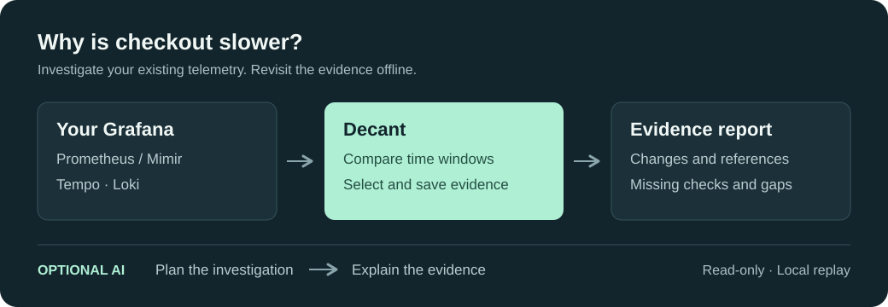

<p align="center">
  
</p>

<h1 align="center">Decant</h1>

<p align="center">Investigate service regressions. Keep the evidence.</p>

<p align="center">
  <a href="#quickstart">Quickstart</a> ·
  <a href="docs/release/GRAFANA_INVESTIGATION.md">Documentation</a> ·
  <a href="docs/release/COMMAND_REFERENCE.md">CLI reference</a>
</p>

Decant is a read-only CLI for investigating latency and error regressions in your
existing Grafana stack. It compares time windows, gathers metrics, traces and logs,
and saves the evidence so you can revisit an investigation offline.

Use it without an LLM for a before-and-after report, or connect your own model to
ask **“Why is checkout slower?”** Measurements, model interpretations and missing
checks stay separate.

<picture>
  <source media="(max-width: 600px)" srcset="docs/assets/investigation-flow-mobile.svg">
  
</picture>

**Source alpha.** Build from source; signed binaries are not available yet.

## Quickstart

Requires Rust **1.98.0** and [platform build prerequisites](docs/release/INVESTIGATION_BINARY.md#from-source).
This build does not require Kafka.

```sh
git clone https://github.com/decant-ai/decant.git
cd decant
cargo build --release --locked -p decant-cli --bin decant --no-default-features
```

Make a read-only Grafana token available as `GRAFANA_TOKEN`. Follow the prompts to
select your service, environment and metric mappings:

```sh
./target/release/decant connect grafana \
  --url https://grafana.example.com \
  --token-env GRAFANA_TOKEN --profile production

./target/release/decant investigate configure --profile production
./target/release/decant investigate --profile production --since 15m
```

Replace the URL with your Grafana instance. The report compares the last 15 minutes
with the preceding 15 minutes. Prometheus or Mimir supplies metrics; Tempo and Loki
are optional. No model account is needed.

[Connection, permissions and metric setup →](docs/release/GRAFANA_INVESTIGATION.md)

## Ask a question

For an AI explanation, make your Anthropic key available as `ANTHROPIC_API_KEY`
and replace `YOUR_MODEL_ID` with your chosen model:

```sh
./target/release/decant investigate ask \
  --profile production --question "Why is checkout slower?" \
  --model YOUR_MODEL_ID --model-key-env ANTHROPIC_API_KEY \
  --allow-model-egress
```

This workflow makes at most two model calls: plan, then explain. Queries,
comparisons and evidence selection run without intermediate model calls.
Your question, confirmed service/environment names and selected evidence are sent
to Anthropic; calls may incur charges. Raw traces and log bodies are not sent.

[Model access and data sharing →](docs/release/GRAFANA_INVESTIGATION.md#ask-a-question)

## Keep the evidence

Each investigation saves a local bundle. Use its printed ID to verify and render
the report again without querying Grafana or calling a model:

```sh
./target/release/decant investigate report --bundle BUNDLE_ID
```

Bundles can contain sensitive backend responses. Keep them private and review
reports before sharing. [Replay and follow-ups →](docs/release/INVESTIGATION_REPLAY.md)

## Supported inputs

- **Grafana:** Prometheus/Mimir metrics, with optional Tempo traces and Loki log counts.
- **OTel trace captures:** [analyze JSONL locally](docs/release/EVIDENCE_QUICKSTART.md).
- **Kafka JSON:** [compile mapped events into evidence](docs/release/KAFKA_EVIDENCE.md).

File, Kafka and [MCP](docs/release/MCP_COMPATIBILITY.md) commands require the full
build; omit `--no-default-features` and follow its [build prerequisites](CONTRIBUTING.md#development-workflow).

Grafana investigations require a request counter and a classic latency histogram
in seconds. Native histograms, traffic-mix attribution and version comparisons
are not supported on this path. Decant does not execute fixes or write to
production. [Known limitations →](docs/release/KNOWN_LIMITATIONS.md)

## Feedback

[Report a bug or share a use case](https://github.com/decant-ai/decant/issues).
Use synthetic reproductions, not production captures or credentials.
See [contributing](CONTRIBUTING.md) for development and
[security](SECURITY.md) for private vulnerability reporting.

## License

[AGPL-3.0-only](LICENSE). Selected configuration examples use Apache-2.0;
see [licensing](LICENSING.md).
